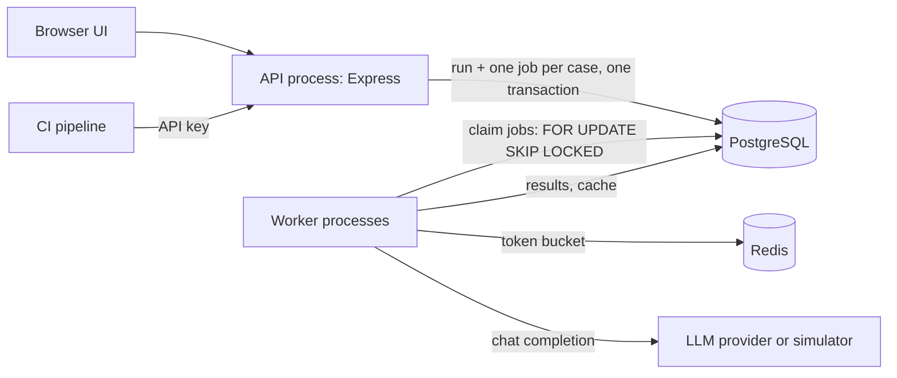

# theRedArmy

Self-hosted regression testing for LLM prompts. Write test cases once, run every new prompt version against them in background workers and see exactly which cases broke. A CI pipeline can call the API and fail the build when a prompt change causes a regression.

[](https://github.com/Ayush-o1/theRedArmy/actions/workflows/ci.yml)
[](LICENSE)


**Contents:** [Why](#why-it-exists) · [Features](#what-it-does) · [How it works](#how-it-works) · [Stack](#tech-stack) · [Quick start](#quick-start) · [Demo](#demo-account) · [Tests](#tests) · [CI gate](#using-it-as-a-ci-gate) · [Structure](#project-structure) · [Docs](#documentation) · [Limitations](#known-limitations)

## Why it exists

Teams that build on large language models change their prompts often: to fix a bug, cut token cost, or switch models. Each change can quietly break behaviour that used to work, and because model output varies, ordinary unit tests catch this poorly. Research on developers building LLM products describes the same problems:

- Classic unit testing broke down ("every test is a flaky test"), and at least one team stopped automated LLM testing because of its cost ([Parnin et al., 2023](https://arxiv.org/abs/2312.14231)).
- People struggled to tell which output differences were real regressions ([RETAIN, 2024](https://arxiv.org/abs/2409.03928)).

Mature tools already exist (Promptfoo, Langfuse, Braintrust, LangSmith), and theRedArmy does not claim to replace them. It is a focused, self-hosted implementation of the core workflow, built to get the hard backend parts right: background jobs, retries, shared rate limits, caching, idempotency and crash recovery. [docs/research.md](docs/research.md) explains how the problem was chosen.

## What it does

- **Immutable prompt versions.** Saving a prompt creates v1, v2, every run records exactly which text it tested.
- **Test suites with deterministic checks:** `contains`, `not_contains`, `equals`, `regex`, `is_json`, `json_field_equals`, length and latency.
- **Background execution.** A run becomes one job per test case. Workers claim jobs from PostgreSQL with `FOR UPDATE SKIP LOCKED`, so any number of workers share the load without running a job twice.
- **Failure handling.** Transient errors (429, 5xx, timeouts) are retried with exponential backoff and jitter, honouring `Retry-After`. Permanent errors are not retried.
- **Crash recovery.** Jobs are leased. If a worker dies, its jobs are reclaimed, and a late write from that worker is rejected.
- **Shared rate limiting.** One Redis token bucket per provider, updated atomically by a Lua script, respected by every worker.
- **Response cache.** Re-running unchanged cases at temperature 0 costs nothing. Exact-match only, scoped per project.
- **Run comparison.** Case by case: regressed, fixed, still failing, added, removed.
- **CI gate.** An API-key endpoint with `Idempotency-Key` support. With a baseline, only regressions fail the gate.
- **Providers.** A built-in simulated provider (free; injects latency and failures) and any OpenAI-compatible API (OpenAI, Groq, OpenRouter, Ollama, LM Studio).

The simulated provider echoes the prompt back instead of generating text. It exercises the pipeline without an API key, but it cannot tell you whether a real prompt is _good_; connect a real provider for that.

| Comparing two prompt versions          | Starting a run and the run history |
| -------------------------------------- | ---------------------------------- |
|  |       |

Screenshots are from the running application with the seeded demo data.

## How it works



1. Starting a run inserts the run and one `run_cases` row per test case **in one transaction**, then returns `202 Accepted`. The `run_cases` table is the job queue.
2. Worker processes claim pending rows with a lease. For each row they render the prompt, check the cache, take a rate-limit token, call the provider, evaluate the checks and store the result. The write is guarded so that only the current lease holder can save.
3. The worker that finishes the last job marks the run complete with a single conditional update.
4. The run is compared with its baseline, and the gate passes or fails.

The API and worker are separate processes that share only PostgreSQL and Redis. Details, sequence diagrams and the security model: [docs/architecture.md](docs/architecture.md).

## Tech stack

| Part         | Choice                                                      |
| ------------ | ----------------------------------------------------------- |
| Runtime      | Node.js 24 (22.9+ supported), Express 5                     |
| Data         | PostgreSQL with Prisma 7; raw SQL where row locking matters |
| Queue        | The `run_cases` table in PostgreSQL                         |
| Shared state | Redis (rate limits, Lua token bucket)                       |
| Validation   | zod                                                         |
| Frontend     | HTML, CSS and vanilla JavaScript modules, no build step     |
| Tests        | `node:test`, supertest, Playwright                          |
| Delivery     | Docker, Docker Compose, GitHub Actions                      |

Why each was chosen, and the trade-offs: [docs/decisions.md](docs/decisions.md).

## Quick start

Requires Node.js 22.9+ and Docker (or your own PostgreSQL and Redis).

```bash
git clone https://github.com/Ayush-o1/theRedArmy.git
cd theRedArmy
npm install

docker compose up -d redis postgres        # Redis :6379, PostgreSQL :5433
cp .env.example .env
sed -i.bak "s|^ENCRYPTION_KEY=.*|ENCRYPTION_KEY=$(openssl rand -base64 32)|" .env && rm .env.bak

npm run db:deploy                          # apply migrations
npm run db:seed                            # optional demo data

npm start                                  # API and UI: http://localhost:3000
npm run worker                             # second terminal: executes runs
```

Only `DATABASE_URL` and `ENCRYPTION_KEY` are required; `.env.example` already matches the Docker services.

- Full guide with troubleshooting: [docs/setup.md](docs/setup.md)
- Every environment variable: [docs/configuration.md](docs/configuration.md)
- Everything in containers: `ENCRYPTION_KEY=$(openssl rand -base64 32) docker compose --profile full up --build`

## Demo account

`npm run db:seed` creates a demo account **for local development only**. The password is public in this repository; never seed a deployment that other people can reach.

| Email                         | Password          |
| ----------------------------- | ----------------- |
| `aarav.mehta@theredarmy.test` | `theRedArmy-demo` |

The account owns **Monsoon Market — Customer Support**, a fictional online store whose support team tests the prompt that drafts replies to customer tickets. Its suite has eight tickets from customers across India.

- **v1** of the prompt quotes the customer's order number. All 8 cases pass.
- **v2** was shortened to save tokens and dropped the order number. **7 cases regress.** The eighth, a delivery-area question with no order, still passes.

Start the worker, open the newer run, and choose **Compare with baseline**. The simulated provider fails about 15% of calls on purpose, so some cases show retries.

## Tests

```bash
cp .env.test.example .env.test       # then set ENCRYPTION_KEY, and create the test database once
npm test                             # unit + integration, against real PostgreSQL and Redis
npm run test:e2e                     # Playwright: full user journeys in Chromium
npm run lint && npm run format:check
```

The tests truncate every table, so they need their own database. The integration tests reproduce the races they guard against: two workers claiming the same run, a crashed worker's job being reclaimed, concurrent finalization, and concurrent idempotent requests. [docs/testing.md](docs/testing.md) covers setup and coverage.

GitHub Actions runs lint, formatting, all three test levels and a dependency audit on every push to `main` and every pull request ([docs/ci-cd.md](docs/ci-cd.md)).

## Using it as a CI gate

Create an API key under **Settings & CI**, then from your pipeline;

```bash
curl -X POST "$THEREDARMY_URL/api/v1/runs" \
  -H "Authorization: Bearer $THEREDARMY_KEY" \
  -H "Content-Type: application/json" \
  -H "Idempotency-Key: $GITHUB_SHA" \
  -d '{"prompt":"ticket-reply","suite":"core-tickets","provider":"simulator","baseline":"previous"}'
```

Poll `GET /api/v1/runs/<id>` until `run.gate.status` is `passed` or `failed`. A retried step with the same `Idempotency-Key` gets the original run back. A complete GitHub Actions job: [docs/ci-cd.md](docs/ci-cd.md#example-github-actions-job). API reference: [docs/api.md](docs/api.md).

## Project structure

```
src/
  server.js, worker.js    process entry points
  app.js                  Express app: security headers, middleware, routes
  config.js               environment validation
  engine/                 run execution: queue SQL, job processing, retries,
                          rate limiter, cache, assertions, providers
  modules/                one folder per resource: routes + service
  middleware/             auth, CSRF, rate limiting, errors, request ids
  lib/                    crypto, errors, validation helpers
public/                   web UI (static files, no build step)
prisma/                   schema and migrations
scripts/seed.js           demo data
test/                     unit and integration tests
e2e/                      Playwright tests
docs/                     documentation and screenshots
```

## Documentation

| Guide                                           | Contents                                                           |
| ----------------------------------------------- | ------------------------------------------------------------------ |
| [setup.md](docs/setup.md)                       | Local setup, test setup, Docker, troubleshooting                   |
| [configuration.md](docs/configuration.md)       | Every environment variable                                         |
| [architecture.md](docs/architecture.md)         | Components, request flows, the job queue, error handling, security |
| [database.md](docs/database.md)                 | Schema, constraints, indexes and why                               |
| [api.md](docs/api.md)                           | Every endpoint, including the CI API                               |
| [decisions.md](docs/decisions.md)               | Design decisions, alternatives and trade-offs                      |
| [testing.md](docs/testing.md)                   | Test strategy, commands and coverage                               |
| [ci-cd.md](docs/ci-cd.md)                       | The CI workflow, and using theRedArmy as a gate                    |
| [research.md](docs/research.md)                 | How the problem was chosen, with sources                           |
| [learning-guide.md](docs/learning-guide.md)     | The project explained from first principles                        |
| [repository-audit.md](docs/repository-audit.md) | Repository quality audit and its decisions                         |

## Known limitations

- **Checks are deterministic only.** There is no LLM-as-judge or semantic-similarity check.
- **One owner per project.** No teams, roles or sharing.
- **Workers poll** PostgreSQL every second when idle; `LISTEN/NOTIFY` would remove that delay.
- **The SSRF guard has a DNS-rebinding gap**: the provider hostname is resolved for the check and again by `fetch` ([decisions.md](docs/decisions.md)).
- **Costs are estimates**, from token counts and the prices you enter.
- **Real models via OpenAI-compatible APIs only**; no native Anthropic or Gemini adapter.
- **No password reset or email verification.**
- **Not production-hardened.** Security controls are implemented and tested, but there has been no external audit, load test or deployment. Behind a reverse proxy, Express `trust proxy` must be configured first ([configuration.md](docs/configuration.md#behind-a-reverse-proxy)).

## Security

Please report vulnerabilities privately, not in a public issue. See [SECURITY.md](SECURITY.md).

## Contributing

Setup, conventions and the checks a change must pass: [CONTRIBUTING.md](CONTRIBUTING.md).

## License

[MIT](LICENSE)
