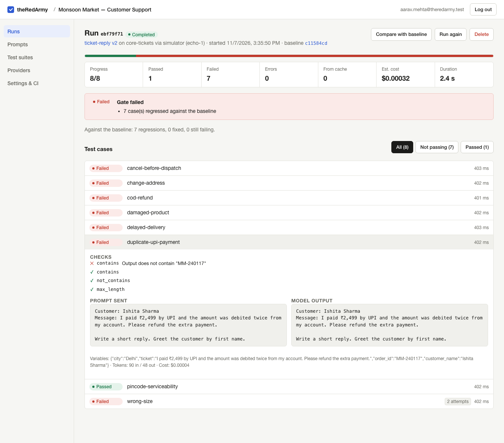
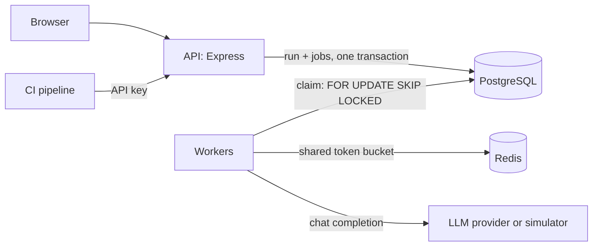
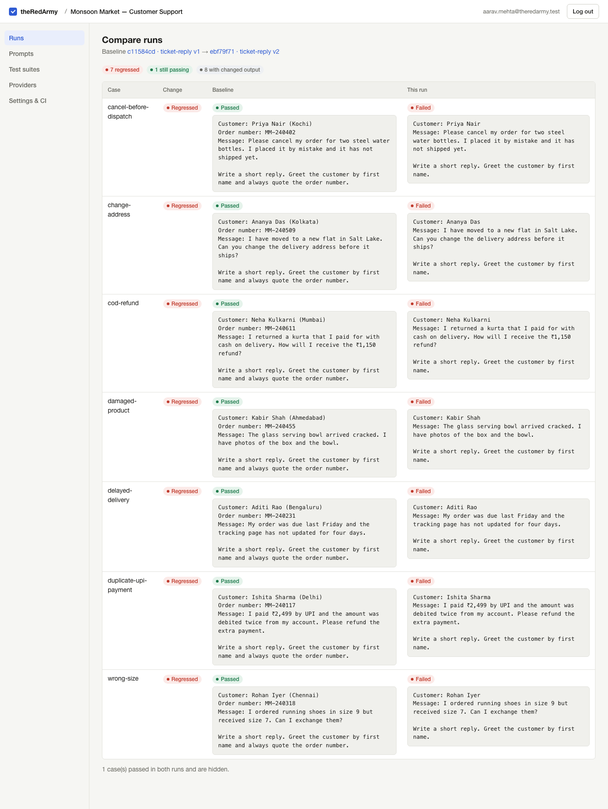
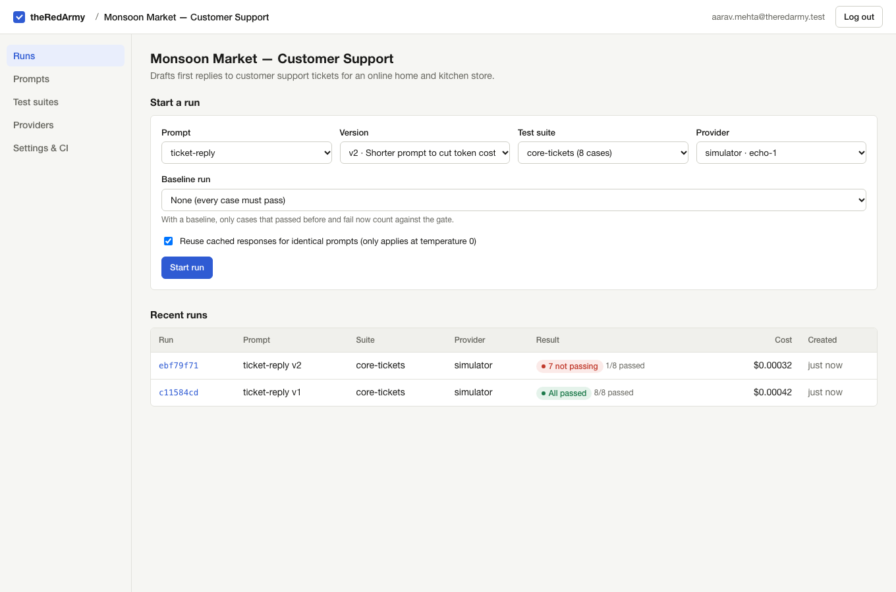

# theRedArmy

**Regression testing for LLM prompts.** Write test cases once, run every new prompt version against them in background workers, and see exactly which cases broke. A CI pipeline can call the API and fail the build when a prompt change causes a regression.




**Contents:** [Problem](#the-problem) · [How it works](#how-it-works) · [Features](#features) · [Screenshots](#screenshots) · [Tech stack](#tech-stack) · [Quick start](#quick-start) · [Demo account](#demo-account) · [Tests](#running-the-tests) · [CI](#using-it-from-ci) · [Structure](#project-structure) · [Docs](#documentation) · [Limitations](#known-limitations)

---

## The problem

Teams that build on large language models change their prompts often: to fix a bug, cut token cost, or switch models. Each change can quietly break behaviour that used to work, and because model output varies, ordinary unit tests do not catch it well. Studies of developers building LLM products describe this directly:

- Engineers found that classic unit testing breaks down ("every test is a flaky test"), and at least one team stopped automated LLM testing because of its cost ([Parnin et al., _Building Your Own Product Copilot_, 2023](https://arxiv.org/abs/2312.14231)).
- Users of LLM regression tools struggled to spot which output differences were regressions and to track how prompt edits affected outputs ([_RETAIN_, arXiv 2409.03928, 2024](https://arxiv.org/abs/2409.03928)).

Good tools already exist for this (Promptfoo, Langfuse experiments, Braintrust, LangSmith). theRedArmy does not claim to fill an empty market gap. It is a focused, self-hosted implementation of the core workflow, built to get the backend parts right: background jobs, retries, rate limits, caching, idempotency and crash recovery. [docs/RESEARCH.md](docs/RESEARCH.md) explains how the problem was chosen.

## How it works

1. **Version the prompt.** Saving a prompt creates an immutable version (v1, v2, …) with `{{variable}}` placeholders.
2. **Describe the expected behaviour.** A test suite holds cases: values for the variables, plus checks on the output (`contains`, `regex`, `is_json`, length…).
3. **Run it.** Starting a run creates one job per test case in the same database transaction. The API returns immediately.
4. **Workers execute.** Worker processes claim jobs from Postgres, call the model, evaluate the checks and save results. They retry transient failures, share one rate limit through Redis, and reuse cached answers for unchanged cases.
5. **Compare.** A run with a baseline is compared case by case. Only cases that passed before and fail now count as regressions.
6. **Gate.** A CI job starts a run through the API and fails the build when the gate fails.



Full walkthrough: [docs/ARCHITECTURE.md](docs/ARCHITECTURE.md).

## Features

| Feature                       | Details                                                                                                                                                      |
| ----------------------------- | ------------------------------------------------------------------------------------------------------------------------------------------------------------ |
| **Immutable prompt versions** | Past runs always point at the exact text they used.                                                                                                          |
| **Test suites**               | Each case has template variables and deterministic checks (`contains`, `regex`, `is_json`, `json_field_equals`, length, latency…).                           |
| **Background execution**      | Workers claim jobs from Postgres with `FOR UPDATE SKIP LOCKED`, so many workers can share the load without running a job twice.                              |
| **Failure handling**          | Transient errors (429, 5xx, timeouts) are retried with exponential backoff and jitter, honouring `Retry-After`. Permanent errors (401, 400) are not retried. |
| **Crash recovery**            | Jobs are leased. If a worker dies, its jobs are reclaimed, and a late write from that worker is rejected (fencing).                                          |
| **Shared rate limiting**      | A Redis token bucket per provider, updated atomically by a Lua script that all workers share.                                                                |
| **Response cache**            | Re-running unchanged cases at temperature 0 costs nothing. The cache is exact-match and scoped per project.                                                  |
| **Run comparison**            | Case-by-case diff between two runs: regressed, fixed, still failing, added, removed.                                                                         |
| **CI gate**                   | `POST /api/v1/runs` with an API key and an `Idempotency-Key`; a retried CI step returns the original run instead of starting a second one.                   |
| **Tenant isolation**          | Every query is scoped to the project owner. Another user's resources return 404.                                                                             |
| **Providers**                 | A built-in **simulated** provider (free, injects latency and failures) and any **OpenAI-compatible** API (OpenAI, Groq, OpenRouter, Ollama, LM Studio…).     |

> **About the simulated provider:** it echoes the prompt back instead of generating text. It exists to exercise the pipeline (queueing, retries, caching, comparison) without an API key. It cannot tell you whether a real prompt is _good_. For that, connect a real provider.

## Screenshots

All three come from the running application with the seeded demo data (see [Demo account](#demo-account)).

**A run that regressed against its baseline.** The failing check says exactly what is missing:


**Case-by-case comparison of v1 and v2.** Seven cases regressed; the one that still passes is hidden:



**Starting a run, and the run history:**



## Tech stack

| Part            | Choice                             | Why                                                                                                                   |
| --------------- | ---------------------------------- | --------------------------------------------------------------------------------------------------------------------- |
| API             | Node.js 24, Express 5              | Small and familiar; Express 5 forwards errors from async handlers to the error handler.                               |
| Database        | PostgreSQL + Prisma 7              | Relational data with real constraints. Prisma for everyday queries; raw SQL for the queue, where row locking matters. |
| Queue           | Postgres table (`run_cases`)       | A run and its jobs are created in one transaction. No dual-write between a database and a separate queue.             |
| Shared counters | Redis                              | Rate limiting must be atomic and shared across processes. A Lua script does check-and-take in one step.               |
| Validation      | zod                                | One schema validates input and documents its shape.                                                                   |
| Frontend        | HTML, CSS, vanilla JS modules      | Forms and tables need no framework; no build step keeps the Content-Security-Policy strict.                           |
| Tests           | `node:test`, supertest, Playwright | Built-in runner for unit and integration tests; Playwright for real browser journeys.                                 |
| Delivery        | Docker, Docker Compose, GH Actions | One image for API and worker; CI runs every test against real Postgres and Redis.                                     |

Every choice and its trade-offs: [docs/DECISIONS.md](docs/DECISIONS.md).

## Quick start

**Requirements:** Node.js 22.9 or newer (developed and tested on Node 24), and Docker for Redis and, optionally, Postgres.

```bash
git clone https://github.com/Ayush-o1/theRedArmy.git
cd theRedArmy
npm install

# Redis, plus Postgres on port 5433 (user/password/database: theredarmy)
docker compose up -d redis postgres

# Create .env from the example and fill in a random encryption key
cp .env.example .env
sed -i.bak "s|^ENCRYPTION_KEY=.*|ENCRYPTION_KEY=$(openssl rand -base64 32)|" .env && rm .env.bak

npm run db:deploy      # apply migrations
npm run db:seed        # optional: demo account with a real regression

npm start              # API + UI on http://localhost:3000
npm run worker         # in a second terminal: executes runs
```

The `sed -i.bak` form works with both macOS and GNU `sed`. If you prefer, open `.env` and paste the output of `openssl rand -base64 32` after `ENCRYPTION_KEY=`.

**Using your own Postgres instead of Docker?** Point `DATABASE_URL` in `.env` at it.

**Everything in containers** (API, worker, Postgres, Redis, and a one-off migration step):

```bash
export ENCRYPTION_KEY=$(openssl rand -base64 32)
docker compose --profile full up --build
```

### Environment variables

| Variable                      | Required | Default                    | Purpose                                                                                                            |
| ----------------------------- | -------- | -------------------------- | ------------------------------------------------------------------------------------------------------------------ |
| `DATABASE_URL`                | yes      | —                          | Postgres connection string                                                                                         |
| `ENCRYPTION_KEY`              | yes      | —                          | 32 random bytes, base64. Encrypts provider API keys. Changing it makes stored keys unreadable.                     |
| `REDIS_URL`                   | no       | `redis://localhost:6379/0` | Rate limiting                                                                                                      |
| `PORT`                        | no       | `3000`                     | API port                                                                                                           |
| `ALLOW_PRIVATE_PROVIDER_URLS` | no       | `false`                    | Allow provider URLs on localhost/private networks (needed for a local Ollama). Keep `false` on shared deployments. |
| `WORKER_CONCURRENCY`          | no       | `4`                        | Jobs one worker process runs at once                                                                               |
| `JOB_LEASE_SECONDS`           | no       | `60`                       | How long a worker may hold a job before it can be reclaimed                                                        |
| `PROVIDER_TIMEOUT_MS`         | no       | `30000`                    | Per-request timeout. Must be at least 5 s shorter than the lease.                                                  |
| `LOG_LEVEL`                   | no       | `info`                     | `silent` in tests. Pipe logs through `npx pino-pretty` to read them.                                               |

The app validates these at startup and exits with a clear message if one is missing or wrong.

### Upgrading a local setup from the old name

This project was previously called PromptGate. Renaming the source does not touch anything already on your machine:

- An existing `.env` or `.env.test` keeps its old `DATABASE_URL`. It still works; update it only if you want the new database names.
- A Postgres Docker volume created before the rename keeps its original user and password, because `POSTGRES_USER` is applied only when the volume is first initialised. Either keep your old `DATABASE_URL`, or recreate the volume with `docker compose down -v`. **That deletes the data in it.**
- Issued API keys (`pgk_…`) and login sessions keep working. The key prefix and the session cookie name were intentionally not renamed.

## Demo account

`npm run db:seed` creates a demo account for **local development only**:

| Email                         | Password          |
| ----------------------------- | ----------------- |
| `aarav.mehta@theredarmy.test` | `theRedArmy-demo` |

This password is public in this repository. Never run the seed against a deployment that other people can reach.

The account owns **Monsoon Market — Customer Support**, a fictional online store whose support team tests the prompt that drafts first replies to tickets. The suite has eight tickets from customers across India: a duplicate UPI payment from Delhi, a delayed delivery in Bengaluru, a wrong shoe size in Chennai, and so on.

- **v1** of the prompt quotes the customer's order number. All 8 cases pass.
- **v2** was "simplified" to save tokens and no longer includes the order number. **7 cases regress.** The eighth, a delivery-area question with no order, still passes.

The seed queues both runs. Start the worker, open the second run, and choose **Compare with baseline**. The simulated provider fails about 15% of calls on purpose, so some cases show retries. The seed is safe to re-run: it replaces the demo account.

## Running the API and worker

| Command                           | What it does                                    |
| --------------------------------- | ----------------------------------------------- |
| `npm start` / `npm run dev`       | API and UI (`dev` restarts on file changes)     |
| `npm run worker`                  | Job worker. Run several for more throughput.    |
| `npm run db:deploy`               | Apply migrations                                |
| `npm run db:migrate`              | Create a new migration after editing the schema |
| `npm run db:seed`                 | Demo data                                       |
| `npm run lint` / `npm run format` | ESLint / Prettier                               |

The API never executes runs itself; without a worker, runs stay `QUEUED`.

## Running the tests

```bash
npm test            # unit + integration (needs Postgres and Redis, uses .env.test)
npm run test:unit   # unit tests only
npm run test:e2e    # Playwright browser tests; starts its own API and worker on port 3100
npm run lint
npm run format:check
```

`npm test` needs a separate test database (for example `theredarmy_test`) configured in `.env.test`. **The tests truncate every table**, so never point it at data you care about. Setup details and what each test covers: [docs/TESTING.md](docs/TESTING.md).

## Using it from CI

Create an API key under **Settings & CI** and store it as a CI secret, for example `THEREDARMY_KEY`.

```bash
# Start a run of the latest version of "ticket-reply", compared with the previous version
curl -X POST http://localhost:3000/api/v1/runs \
  -H "Authorization: Bearer $THEREDARMY_KEY" \
  -H "Content-Type: application/json" \
  -H "Idempotency-Key: $GITHUB_SHA" \
  -d '{"prompt":"ticket-reply","suite":"core-tickets","provider":"simulator","baseline":"previous"}'

# Poll until run.gate.status is "passed" or "failed"
curl http://localhost:3000/api/v1/runs/<run id> -H "Authorization: Bearer $THEREDARMY_KEY"
```

Using the commit SHA as the `Idempotency-Key` means a retried CI step returns the original run instead of starting a second one. Full reference: [docs/API.md](docs/API.md).

## Project structure

```
src/
  server.js, worker.js      process entry points
  app.js                    Express app (middleware, routes)
  config.js                 validated environment variables
  engine/                   everything that executes runs
    queue.js                claim / complete / reschedule / reclaim jobs (SQL)
    processJob.js           one test case, end to end
    worker.js               poll loop, concurrency, lease reaper
    rateLimiter.js          Redis token bucket (Lua)
    responseCache.js        exact-match cache
    assertions.js           output checks
    backoff.js, template.js
    providers/              simulated, OpenAI-compatible, SSRF guard
  modules/                  HTTP routes + services per resource
  middleware/               auth, CSRF, rate limiting, errors, request ids
  lib/                      crypto, errors, validation helpers
public/                     the web UI (no build step)
prisma/                     schema and migrations
scripts/seed.js             demo data
test/                       unit and integration tests
e2e/                        Playwright tests
docs/                       documentation and screenshots
```

## Documentation

- [Research and problem selection](docs/RESEARCH.md)
- [Architecture](docs/ARCHITECTURE.md): components, request flows, the job queue, security
- [Database design](docs/DATABASE.md)
- [API reference](docs/API.md)
- [Design decisions and trade-offs](docs/DECISIONS.md)
- [Testing](docs/TESTING.md)
- [Learning guide](docs/LEARNING_GUIDE.md): understand the project from scratch and prepare to discuss it

## Known limitations

These are real gaps, not planned features presented as done:

- **Checks are deterministic only.** There is no LLM-as-judge or semantic-similarity check, so free-form answers can only be tested with text, regex, JSON and length rules.
- **One owner per project.** No teams, roles or sharing.
- **Workers poll** Postgres every second when idle. Fine at this scale; `LISTEN/NOTIFY` would remove the delay.
- **SSRF guard has a DNS-rebinding gap.** The provider hostname is resolved for the check and again by `fetch`. See [DECISIONS.md](docs/DECISIONS.md).
- **Cost figures are estimates**, from token counts and the prices you enter.
- **Only OpenAI-compatible APIs** are supported for real models; there is no native Anthropic or Gemini adapter.
- **No password reset or email verification.**
- **Not production-hardened.** Basic security controls are in place and tested (see [ARCHITECTURE.md § Security](docs/ARCHITECTURE.md#security)), but there has been no external audit, load test or deployment behind a real proxy. Behind a reverse proxy you must configure Express `trust proxy` so rate limits see client IPs.

## License

`package.json` declares the MIT license. The repository does not yet include a `LICENSE` file.
