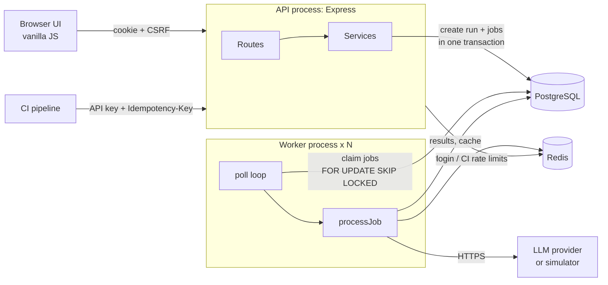
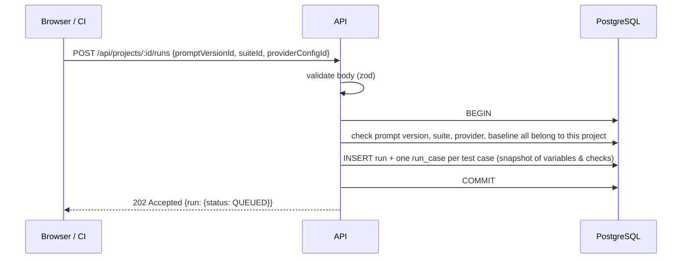
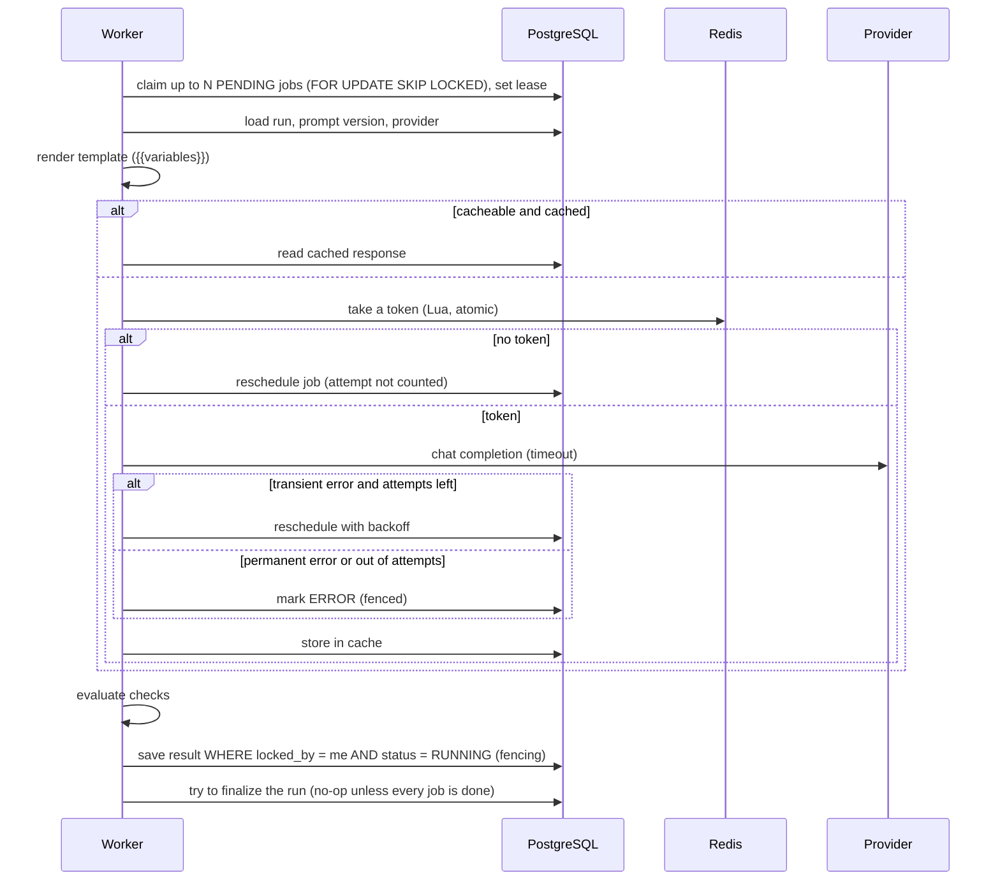
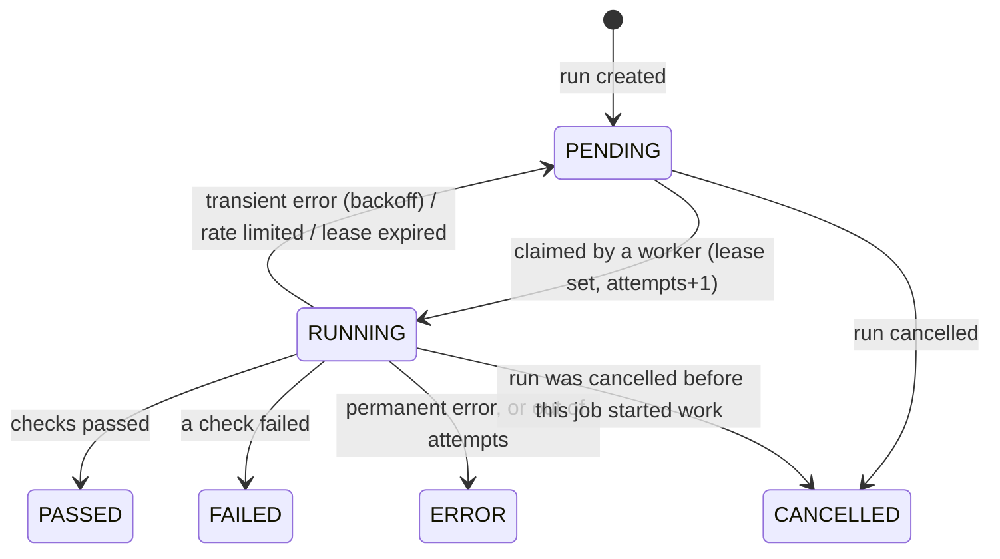

# Architecture

PromptGate is a **modular monolith**: one codebase and one database, deployed as two kinds of process.

- **API process** (`src/server.js`): serves the web UI and the JSON API. It never calls an LLM.
- **Worker process** (`src/worker.js`): executes test cases. Run as many as you need.

They never talk to each other directly. They coordinate through **PostgreSQL** (data and job queue) and **Redis** (shared rate-limit counters).

## Simple explanation first

Think of a restaurant.

- **The API** is the waiter: it takes the order ("run prompt v2 against my 50 test cases"), writes 50 tickets and pins them on the board, then immediately tells you "order received". That is the `202 Accepted` response.
- **The board** is the `run_cases` table. Each ticket is one test case to execute.
- **The workers** are cooks. Each cook takes free tickets off the board. A cook who grabs a ticket puts a hand on it, so no other cook takes the same one. That is the row lock.
- If a cook faints mid-dish, a manager notices the ticket has been held too long and puts it back on the board. That is the lease and the reaper. If the fainted cook wakes up later and tries to serve the old dish, they are turned away, because the ticket now belongs to someone else. That is fencing.
- The kitchen may only send 60 requests a minute to its supplier, whichever cook is asking. A shared counter on the wall enforces that. That is the Redis token bucket.
- If an identical dish was cooked before, it is served from the fridge. That is the response cache.

## Code layout

| Layer        | Folder                           | Responsibility                                                                           |
| ------------ | -------------------------------- | ---------------------------------------------------------------------------------------- |
| Entry points | `src/server.js`, `src/worker.js` | Start the process, handle graceful shutdown                                              |
| HTTP         | `src/app.js`, `src/middleware/`  | Security headers, request ids and logging, sessions, CSRF, rate limits, error format     |
| Resources    | `src/modules/<name>/`            | `*.routes.js` validates input and shapes HTTP responses; `*.service.js` holds data logic |
| Execution    | `src/engine/`                    | Queue SQL, job processing, providers, retries, rate limiting, caching, assertions        |
| Shared       | `src/lib/`                       | Crypto, error types, validation helper                                                   |
| UI           | `public/`                        | Static files served by Express                                                           |

Routes never contain business logic beyond input parsing, and the engine knows nothing about HTTP. That is why `compare.js`, `assertions.js` and `backoff.js` are unit-tested without a server or database.

## Request flows

### 1. Starting a run

Code: [`createRun`](../src/modules/runs/runs.service.js).

- **Why one transaction?** If the run were inserted and the process crashed before the jobs were inserted, the run would sit in `QUEUED` forever. With one transaction, either everything exists or nothing does.
- **Why snapshot the test cases?** If someone edits a case after the run, the run must still show what it actually tested. Otherwise comparisons between old and new runs would be meaningless.

### 2. Executing a job (worker)

Code: [`processJob`](../src/engine/processJob.js), [`queue.js`](../src/engine/queue.js), [`worker.js`](../src/engine/worker.js).

### 3. CI gate

1. `POST /api/v1/runs` with `Authorization: Bearer pgk_…` and `Idempotency-Key: <commit sha>`.
2. Names are resolved to ids. `"baseline": "previous"` finds the latest completed run of an earlier version of the same prompt, suite and provider.
3. If the idempotency key was used before with the same body, the original run is returned (`200`, `Idempotent-Replayed: true`). With a different body, the API returns `422`.
4. CI polls `GET /api/v1/runs/:id` until `gate.status` is `passed` or `failed`.

The gate rules ([`evaluateGate`](../src/modules/runs/compare.js)):

| Situation                                                          | Gate                                       |
| ------------------------------------------------------------------ | ------------------------------------------ |
| Run still queued or running                                        | `pending`                                  |
| Run cancelled                                                      | `failed`                                   |
| Any case **errored** (model never answered)                        | `failed`: an unverified case is not a pass |
| With a baseline: any case **regressed** (passed before, fails now) | `failed`                                   |
| With a baseline: cases that failed before and still fail           | tolerated                                  |
| Without a baseline: any case failed                                | `failed`                                   |

## The job queue in detail

The queue is the most important design in the project.

**Job states** (`run_cases.status`):

**Guarantees and how each one is enforced:**

| Guarantee                                          | Mechanism                                                                       | Test                                                     |
| -------------------------------------------------- | ------------------------------------------------------------------------------- | -------------------------------------------------------- |
| A job is never run by two workers at once          | `FOR UPDATE SKIP LOCKED` in the claim query                                     | _two workers on the same run never process a case twice_ |
| A crashed worker's jobs are recovered              | Each claim sets `lease_expires_at`; the reaper resets expired jobs to `PENDING` | _jobs held by a crashed worker are recovered…_           |
| A late worker cannot overwrite a newer result      | Every completion checks `locked_by = me AND status = 'RUNNING'`                 | same test: the stale write returns `false`               |
| A job that keeps crashing workers eventually stops | Attempts are counted at claim time; the reaper marks `ERROR` at `max_attempts`  | _a job whose worker keeps dying gives up…_               |
| Exactly one worker finalizes a run                 | Conditional `UPDATE … WHERE status IN (…) AND NOT EXISTS (unfinished jobs)`     | _finalization is idempotent under concurrent calls_      |
| A provider call cannot outlive its lease           | Startup check: lease must exceed the provider timeout by 5 s or more            | `config.js`                                              |

**Delivery semantics:** this is _at-least-once_ execution of the provider call. If a worker gets a response but dies before saving it, the job runs again. For a testing tool that is acceptable: the cost is one extra API call, with no external side effect. The fencing check means a result is _recorded_ at most once.

## Error handling

- **Validation errors** → `400` with every invalid field listed (`details: [{path, message}]`).
- **Known conditions** are thrown as `AppError` (`404`, `409`, `422`, `429`…) from [`lib/errors.js`](../src/lib/errors.js).
- **Unknown errors** are logged in full with the request id and returned as a generic `500` with `requestId`, so internals are never leaked.
- Express 5 passes errors from `async` handlers to the error handler, so there is no try/catch boilerplate in routes.
- **Database constraint errors** are translated where they carry meaning: Prisma `P2002` (unique) → `409`, `P2003` (foreign key restrict) → `409` "has runs".
- In the worker, a crashing job is logged and its lease simply expires; the reaper retries it.

## Validation strategy

All external input is validated with zod at the route boundary: body, query and path ids. Path ids that are not UUIDs return `404` before reaching the database. Assertions are validated when saved (an invalid regex is rejected immediately, not discovered during a run). Business rules that need the database (does this suite belong to this project?) are checked in services, inside the transaction that uses them.

## Security

| Threat                              | Control                                                                                              | Where                                          |
| ----------------------------------- | ---------------------------------------------------------------------------------------------------- | ---------------------------------------------- |
| Stolen password database            | scrypt hashes with per-user salt                                                                     | `lib/crypto.js`                                |
| Login brute force                   | 10 attempts per 15 min per IP + email (Redis)                                                        | `auth.routes.js`                               |
| User enumeration                    | Same error and similar timing for unknown email vs wrong password                                    | `auth.service.js`                              |
| Session theft via XSS               | `httpOnly` cookie; strict CSP; UI never uses `innerHTML`                                             | `auth.routes.js`, `app.js`, `public/js/dom.js` |
| Stolen session table                | Only SHA-256 of session tokens and API keys is stored                                                | `middleware/auth.js`                           |
| CSRF                                | `SameSite=Lax` cookie + synchronizer token header on every state change                              | `middleware/auth.js`                           |
| Cross-tenant access (IDOR)          | Every query filters by project, and every project by owner; foreign resources return `404`           | services, `loadOwnedProject`                   |
| Leaked provider API keys            | AES-256-GCM encryption at rest; never returned by the API                                            | `lib/crypto.js`, `providers.service.js`        |
| SSRF via provider base URL          | Scheme check, no credentials in URL, private/loopback/link-local IPs blocked, redirects refused      | `engine/providers/urlGuard.js`                 |
| Cross-tenant cache leak             | Project id is part of the cache key                                                                  | `responseCache.js`                             |
| SQL injection                       | Prisma parameterises queries; raw SQL uses tagged templates (parameters, never string concatenation) | `engine/queue.js`                              |
| Runaway cost (OWASP LLM10)          | Per-provider rate limit, max tokens per version, cache                                               | engine                                         |
| Malicious model output (stored XSS) | Rendered as text nodes only; e2e test injects `<script>`                                             | `e2e/`                                         |

**What is not covered:** DNS-rebinding against the SSRF check, account lockout notifications, password reset, audit logging, and secret rotation for `ENCRYPTION_KEY`. No external security review has been done.

## Observability

- Structured JSON logs (pino) with a request id on every API log line, and a worker id plus job id on every worker log line. Authorization headers, cookies and API keys are redacted.
- `GET /api/health` checks Postgres and Redis (`503` if either is down).
- Each run records attempts, latency, tokens, cost and cache hits per case, which is the data you need to debug a bad run.
- Not implemented: metrics endpoint (Prometheus), tracing. See the README limitations.

## Deployment

- `Dockerfile` builds one image (non-root user, production dependencies only). The command chooses API or worker.
- `docker compose --profile full up` runs a one-shot `migrate` container, then the API and worker, which wait for it to finish.
- GitHub Actions runs lint, formatting, unit, integration and browser tests against real Postgres and Redis on every push.
