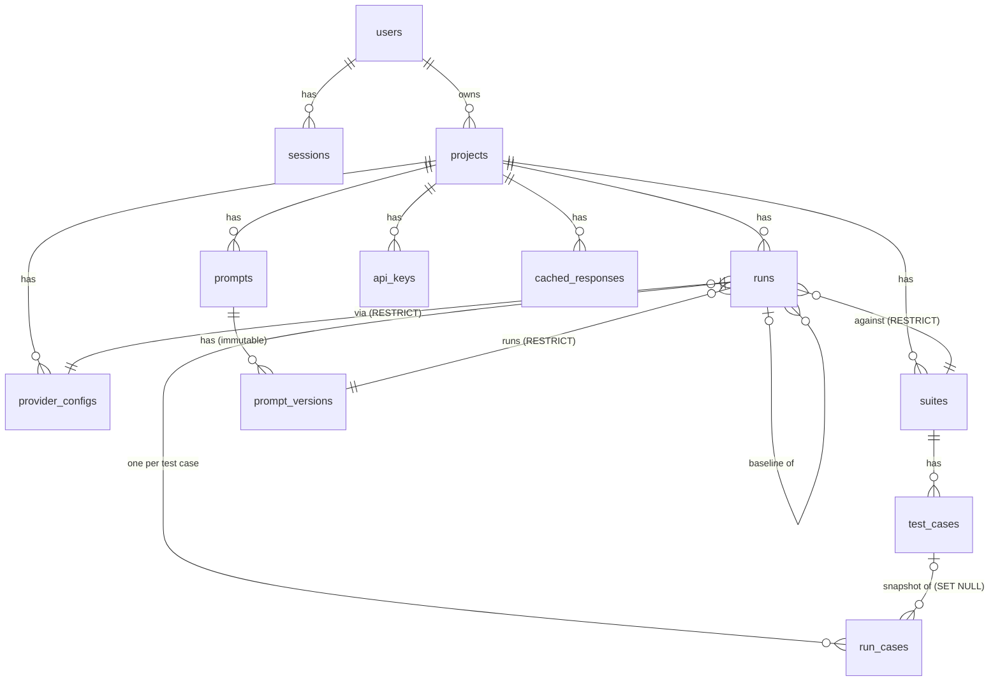

# Database design

PostgreSQL, managed with Prisma. Schema: [`prisma/schema.prisma`](../prisma/schema.prisma). Generated SQL: [`prisma/migrations/`](../prisma/migrations/).

## Entity relationships

## Tables

| Table              | Purpose                                    | Key columns                                                                                                                     |
| ------------------ | ------------------------------------------ | ------------------------------------------------------------------------------------------------------------------------------- |
| `users`            | Accounts                                   | `email` unique, `password_hash` (scrypt)                                                                                        |
| `sessions`         | Logged-in browsers                         | `token_hash` unique (SHA-256 of the cookie), `csrf_token`, `expires_at`                                                         |
| `projects`         | Top-level container, one owner             | unique `(owner_id, name)`                                                                                                       |
| `provider_configs` | Where prompts are sent                     | `kind`, `model`, `base_url`, `api_key_ciphertext` (AES-GCM), `requests_per_minute`, prices, `settings` (simulator knobs, JSONB) |
| `prompts`          | A named prompt                             | unique `(project_id, name)`, `latest_version` counter                                                                           |
| `prompt_versions`  | Immutable versions                         | unique `(prompt_id, version)`, `template`, `system_prompt`, `temperature`, `max_tokens`                                         |
| `suites`           | Set of test cases                          | unique `(project_id, name)`                                                                                                     |
| `test_cases`       | Inputs and checks                          | unique `(suite_id, name)`, `variables` JSONB, `assertions` JSONB                                                                |
| `runs`             | One execution of a version against a suite | `status`, aggregate counters, `baseline_run_id`, unique `(project_id, idempotency_key)`                                         |
| `run_cases`        | **Job queue and results**                  | `status`, `attempts`, `available_at`, `locked_by`, `lease_expires_at`, output, check results, tokens, cost                      |
| `api_keys`         | CI credentials                             | `key_hash` unique, `prefix`, `revoked_at`                                                                                       |
| `cached_responses` | Exact-match response cache                 | `key` (SHA-256) primary key, `project_id`                                                                                       |

## Design decisions in the schema

### Immutable prompt versions

There is no endpoint that updates a `prompt_versions` row. A run references the exact version it used, so "what text did run X test?" always has one answer.

**Version numbers without races.** Two people saving at once must not both get v5. `prompts.latest_version` is incremented with `UPDATE … SET latest_version = latest_version + 1 RETURNING latest_version` inside the same transaction as the insert. The `UPDATE` takes a row lock, so concurrent saves queue up and get 5 and 6. The unique `(prompt_id, version)` index is a second line of defence. A test fires 10 concurrent saves and checks for versions 2–11 with no gaps or duplicates.

### Snapshots instead of live references

`run_cases.variables` and `run_cases.assertions` are **copied** from the test case when the run is created. Editing a test case later does not rewrite history. `run_cases.test_case_id` is `ON DELETE SET NULL`, so deleting a test case keeps old results, and comparison falls back to matching by `case_name`.

### Foreign key actions are deliberate

| Relationship                            | On delete  | Why                                                                                                     |
| --------------------------------------- | ---------- | ------------------------------------------------------------------------------------------------------- |
| project → everything                    | `CASCADE`  | Deleting a project deletes all of its data                                                              |
| run → prompt version / suite / provider | `RESTRICT` | You cannot delete something that run history depends on; the API returns `409 "This provider has runs"` |
| run → baseline run                      | `SET NULL` | Deleting an old run does not delete the runs compared against it                                        |
| run_case → test_case                    | `SET NULL` | Keep results when a case is deleted                                                                     |

Because of `RESTRICT`, deleting a project first deletes its runs and then the project, in one transaction ([`deleteProject`](../src/modules/projects/projects.service.js)).

### `run_cases` is the queue

Instead of a separate queue (Redis/BullMQ, RabbitMQ), the rows that hold results also hold queue state. Advantages:

- Creating a run and enqueueing its jobs is **one transaction**.
- The results and the queue can never disagree.
- One less system to run.

Cost: Postgres is not built for very high queue throughput. For a testing tool, where each job waits seconds for an LLM, this does not matter. See [DECISIONS.md](DECISIONS.md).

### Indexes and why each exists

| Index                                                 | Used by                                                                   |
| ----------------------------------------------------- | ------------------------------------------------------------------------- |
| `run_cases (status, available_at)`                    | The worker's "next ready job" query, run every second                     |
| `run_cases (run_id, status)`                          | Live progress counts and the "unfinished jobs?" check during finalization |
| `run_cases (run_id, test_case_id)` unique             | One job per case per run                                                  |
| `runs (project_id, created_at)`                       | Run list, newest first                                                    |
| `runs (project_id, idempotency_key)` unique           | Idempotent CI requests; it also blocks concurrent duplicates              |
| `sessions (token_hash)`, `api_keys (key_hash)` unique | Auth lookups on every request                                             |

### Aggregates are written once

`runs.passed_cases`, `failed_cases`, `cost_usd` and the other totals are computed with one aggregate query when the run finishes, instead of being incremented by each worker. Incrementing from many workers is possible but easy to get wrong. A single `UPDATE … FROM (SELECT count(*) …)` guarded by "no unfinished jobs" is correct by construction. While a run is in progress, the API counts live from `run_cases`.

### Types

- UUID primary keys (`@db.Uuid`): ids in URLs cannot be guessed or enumerated.
- `timestamptz(3)`: all times stored in UTC with millisecond precision.
- `JSONB` for variables, assertions and simulator settings. These are flexible, validated documents, always read and written as a whole, never queried by field, so separate tables would add joins without benefit.
- `cost_usd` is a `float8`. It is an estimate for display, not money that is billed, so floating-point rounding is acceptable. A billing system would use integer micro-units or `numeric`.

## Migrations

- `npm run db:migrate`: after editing `schema.prisma` during development; creates a new SQL migration.
- `npm run db:deploy`: applies pending migrations (CI, Docker, production).
- Migrations are committed to Git and never edited after being applied.
